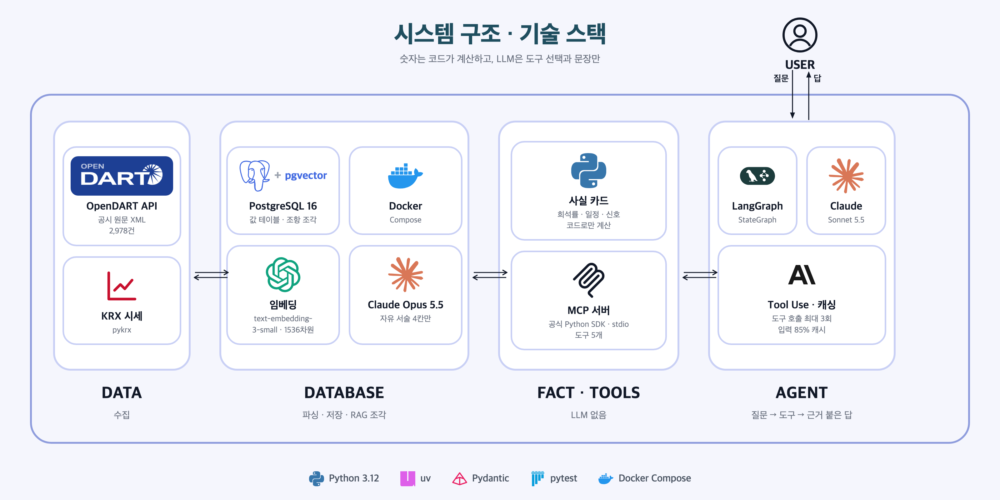
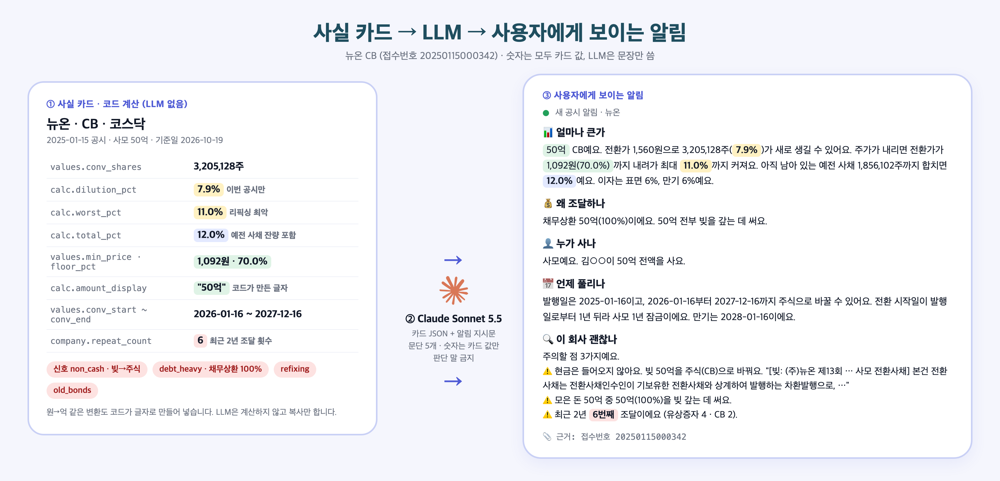
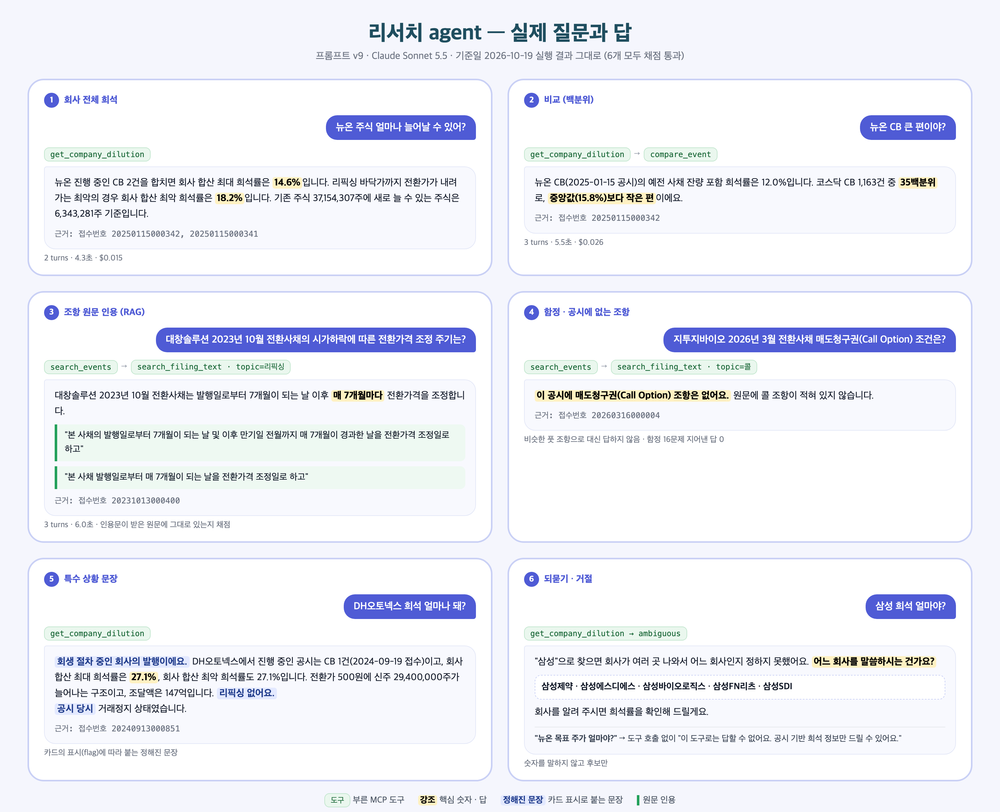
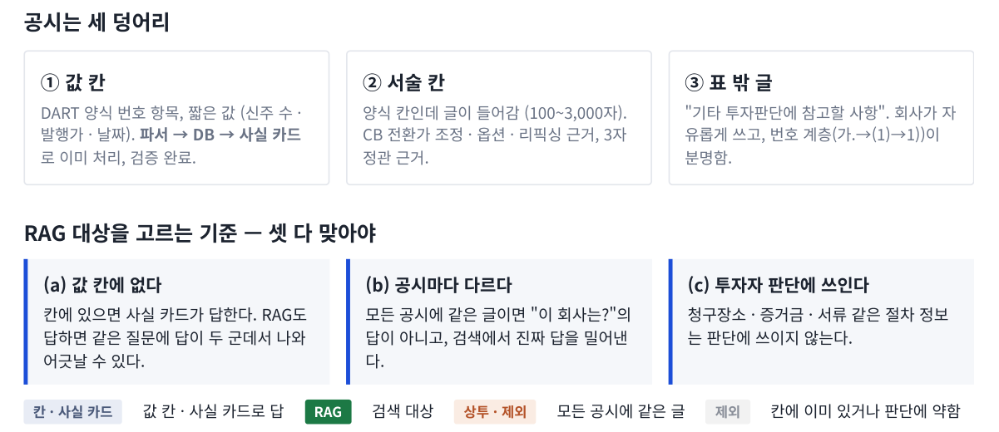
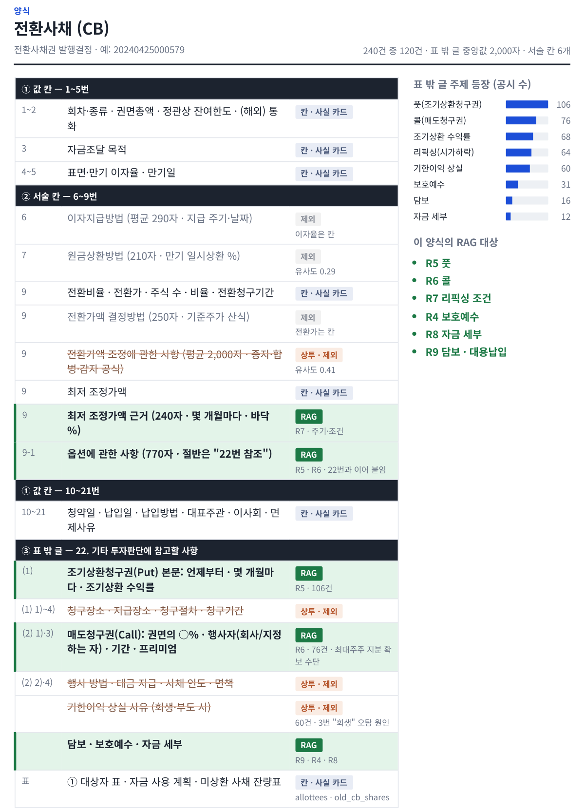
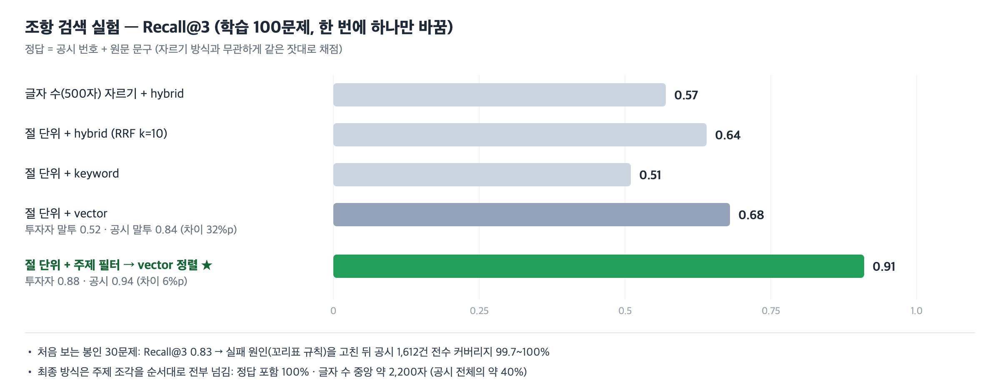

# 유상증자 · CB 공시 희석 리스크 리서치 agent

DART 유상증자 · 전환사채(CB) 공시를 구조화해서 **"이 공시로 주식이 얼마나 늘어나나, 언제 풀리나, 조건은 무엇인가"**를 숫자와 원문 근거로 답하는 리서치 agent입니다.
**숫자는 코드가 계산하고, LLM은 도구 선택과 문장만 맡습니다.**

| 질문 | 실제 답 (요약) |
|---|---|
| 뉴온 주식 얼마나 늘어날 수 있어? | 회사 합산 최대 희석률 14.6%, 최악 18.2% · 근거 접수번호 |
| 뉴온 CB 큰 편이야? | 코스닥 CB 1,163건 중 35백분위, 중앙값(15.8%)보다 작은 편 |
| 대창솔루션 2023년 10월 전환사채의 시가하락에 따른 전환가격 조정 주기는? | 원문 인용 "본 사채의 발행일로부터 7개월이 되는 날 및 이후 만기일 전월까지 매 7개월이 경과한 날을 전환가격 조정일로 하고" |
| 지투지바이오 2026년 3월 전환사채 매도청구권(Call Option) 조건은? (공시에 없는 조항) | "이 공시에 매도청구권(Call Option) 조항은 없어요" |
| 뉴온 목표 주가 얼마야? | "이 도구로는 답할 수 없어요" (도구 호출 없음) |

실제 답 전문 · 사실 카드 JSON · 알림 예시: **[docs/examples.md](docs/examples.md)**

---

## 목차
1. [개요](#1-개요)
2. [시스템 구조](#2-시스템-구조)
3. [실제로 보이는 것: 알림 · agent 답](#3-실제로-보이는-것-알림--agent-답)
4. [데이터: 공시 원문 구조 · 수집 · 저장](#4-데이터-공시-원문-구조--수집--저장)
5. [사실 카드와 출력](#5-사실-카드와-출력)
6. [리서치 agent](#6-리서치-agent)
7. [RAG: 공시 원문 조항 검색](#7-rag-공시-원문-조항-검색)
8. [평가 · 검증](#8-평가--검증)
9. [트러블슈팅](#9-트러블슈팅)
10. [한계 · 다음 단계](#10-한계--다음-단계)
11. [실행 방법 · 폴더 구조](#11-실행-방법--폴더-구조)

---

## 1. 개요
- **문제**: 유상증자 · CB 공시는 표(정형 값)와 긴 줄글(조항)이 섞여 있습니다. 투자자가 희석 규모, 물량이 풀리는 시점, 리픽싱 · 콜 · 풋 조건을 직접 찾기 어렵습니다.
- **접근**: 공시 XML을 **값**과 **조항 글**로 나눠 DB에 저장하고, 값은 코드로 계산해 사실 카드로, 조항은 원문 검색(RAG)으로 제공합니다.
- **대상**: DART 2023~2026 공시 2,978건 (유상증자 1,594 · CB 1,384)

## 2. 시스템 구조



- **DATA**: OpenDART API로 공시 원문 XML 2,978건, KRX 시세(pykrx)
- **DATABASE**: PostgreSQL 16 + pgvector (Docker Compose). 값 테이블과 조항 조각(text-embedding-3-small, 1536차원). 자유 서술 4칸만 Claude Opus 5.5가 채움
- **FACT · TOOLS**: 사실 카드는 코드로만 계산 (LLM 없음), MCP 서버(공식 Python SDK, stdio)가 도구 5개로 노출
- **AGENT**: LangGraph StateGraph + Claude Sonnet 5.5 Tool Use, 도구 호출 최대 3회 · 프롬프트 캐싱

## 3. 실제로 보이는 것: 알림 · agent 답

### 3-1. 사실 카드 → LLM → 사용자에게 보이는 알림



같은 색으로 칠한 숫자가 카드 칸에서 문장으로 그대로 옮겨진 것입니다. LLM은 계산하지 않고, "50억"처럼 코드가 만든 글자를 복사합니다. 전문: [docs/examples.md](docs/examples.md#3-알림--같은-카드로-만든-문단-5개)

### 3-2. 리서치 agent — 실제 질문과 답



모두 v9 실행 결과 그대로이고 채점 통과한 답입니다. 답마다 부른 MCP 도구, 근거 접수번호, 조항 질문이면 원문 인용이 붙습니다. 공시에 없는 조항은 "없어요"라고 답하고(함정 16문제 지어낸 답 0), 회사가 모호하면 숫자 없이 되묻습니다. 전문: [docs/examples.md](docs/examples.md)

## 4. 데이터: 공시 원문 구조 · 수집 · 저장

### 4-1. 공시 원문 구조와 분석
- **240건 표본** (CB 120 · 주주배정 27 · 일반공모 22 · 제3자배정 71) → 양식별 칸 분석 → RAG 후보 9개 (R1~R9)
- **2,978건 전수 확인** → 칸에 이미 있거나 · 모든 공시에 같은 글이거나 · 판단에 약한 것을 빼고 → 최종 4개 (T1~T4: 청약절차 · 리픽싱 · 콜 · 풋)
- **일반공모 · 제3자배정**은 필요한 정보가 칸에 있어 RAG 없이 사실 카드로 답합니다



공시는 값 칸 · 서술 칸 · 표 밖 글 세 덩어리로 되어 있고, "칸에 없고 · 공시마다 다르고 · 판단에 쓰이는" 글만 RAG에 넣었습니다.



CB 양식의 칸마다 사실 카드(값) · RAG · 제외(상투 문구)를 정한 결과입니다. 주주배정 양식 · 최종 RAG 위치 · 일반공모 · 제3자배정은 **[docs/analysis/](docs/analysis/README.md)** 에 있습니다.

**실제 XML 발췌 — CB (헝셩그룹 20260213002703)**. 원문 그대로이고, 긴 줄은 `…`로 줄였습니다.

```xml
<TABLE-GROUP ACLASS="CB_PUB" ADELETETABLE="N">
…
<TD COLSPAN="4" WIDTH="383" HEIGHT="23" AUPDATECONT="N" ENG="2. Total face (or electronically registered) value of bonds (KRW)">2. 사채의 권면(전자등록)총액 (원)</TD>
<TE COLSPAN="5" ALIGN="RIGHT" WIDTH="333" HEIGHT="23" ACODE="DNM_SUM">2,977,280,000</TE>
…
<TD COLSPAN="3" WIDTH="257" HEIGHT="2024" AUPDATECONT="N" ENG="Details of conversion price adjustment">전환가액 조정에 관한 사항</TD>
<TE COLSPAN="5" WIDTH="333" HEIGHT="2024" ACODE="EXE_REG">
<P>1) 회사가 주식배당, 본 전환사채 전환가액을 하회하는 발행가격으로 유상증자 또는 주식관련사채(…)를 발행하는 경우에는 전환가액을 아래의 산식에 따라 조정하기로 한다. …전환가액 = 조정전 전환가액 × [{A + B ×(C/D)} ÷ (A + B)]</P>
…
<TD VALIGN="MIDDLE" WIDTH="143" HEIGHT="23" AUPDATECONT="N" ENG="Minimum refixing price (KRW)">최저 조정가액 (원)</TD>
<TE COLSPAN="5" VALIGN="MIDDLE" ALIGN="RIGHT" WIDTH="333" HEIGHT="23" ACODE="MIN_PRC">122</TE>
…
<TD VALIGN="MIDDLE" WIDTH="143" HEIGHT="368" AUPDATECONT="N" ENG="Legal basis of minimum refixing">최저 조정가액 근거</TD>
<TE COLSPAN="5" VALIGN="MIDDLE" WIDTH="333" HEIGHT="368" ACODE="MIN_RSN">제1호 내지 제3호와 별도로, 발행일로부터 매 3개월 경과일(…) 마다 전환가액을 조정하되 … 높은 가액이 직전 전환가 …</TE>
…
<TD WIDTH="599" HEIGHT="23" AUPDATECONT="N" ENG="23. Other matters to be factored into investment decisions">23. 기타 투자판단에 참고할 사항</TD>
…
<SPAN USERMARK="F-GL11 B">1) 조기상환청구권(Put Option)에 관한 사항</SPAN>
<SPAN USERMARK="F-GL11 ">본 사채의 사채권자는 본 사채의 발행일로부터 1년이 되는 2027년 2월 25일 및 이후 매 3개월에 해당되는 날로서 … 조기상환수익률은 복리 6%로 한다.</SPAN>
…
<P USERMARK="F-GL11 "> 가. 조기상환 청구장소: 발행회사 혹은 발행회사 지정한 공시대리인나. 조기상환 지급장소: 신한은행 서여의도금융센터다. 조기상환 청구기간: … </P>
```

| 원문 | 어디로 | 이유 |
|---|---|---|
| ① 값 칸 `ACODE="DNM_SUM"` 2,977,280,000 | DB `cb_values.amount` → 사실 카드 (`amount_display` "29.8억") | 짧은 값, 항목 코드로 바로 추출 |
| ① 값 칸 `ACODE="MIN_PRC"` 122 | DB `cb_values.min_price` → 리픽싱 바닥가 · 최악 희석률 | 짧은 값 |
| ② 서술 칸 `EXE_REG` 1) 증자 · 합병 · 감자 시 조정 공식 | 제외 (상투) | 거의 모든 CB에 같은 법정 공식 (공시 간 유사도 0.41) |
| ② 서술 칸 `MIN_RSN` "발행일로부터 매 3개월 … 조정" | **RAG 주제 T2 리픽싱** | 주기 · 조건이 공시마다 다르고 글에만 있음 |
| ③ 표 밖 글 23번 1) 조기상환청구권 본문 | **RAG 주제 T4 풋** | 언제부터 · 몇 개월마다 · 수익률 |
| ③ 표 밖 글 23번 가.~ 청구장소 · 지급장소 · 청구기간 | 제외 (상투) | 절차 정보, 판단에 쓰이지 않음 |

이 공시는 "기타 투자판단"이 23번입니다 (양식 버전에 따라 22번 또는 23번). 주주배정 발췌는 [docs/analysis/](docs/analysis/README.md#실제-xml-발췌-유상증자-주주배정-kc코트렐-20230601000403)에 있습니다.

### 4-2. 수집 · 파싱 · 저장
- **수집**: OpenDART 목록 · 원문 API, 시세는 pykrx
- **파싱**: DART XML의 항목 코드(ACODE) 기준으로 값 추출. 정정 표와 본문을 분리
- **LLM이 채우는 칸은 4개뿐**: 납입 방식 · 할인율 · 신주인수권 매매 기간(유상증자), 납입 방식(CB)
  - 규칙으로 먼저 판단 → 안 되면 LLM → 그래도 모르면 "불명"
  - LLM 출력은 코드로 다시 확인 (DART API 대조, 납입 신호)

## 5. 사실 카드와 출력
### 5-1. 사실 카드 (계산 계층, LLM 없음)
- **희석률 3종**: 이번 공시만 / 예전 사채 잔량 포함 / 회사 합산 + 각각의 최악 희석률(리픽싱 바닥가 기준)
- **일정**: 전환 시작 · 상장일 · 만기
- **신호 7종** (리픽싱 · 최대주주 배정 · 현금 아닌 납입 · 거래정지 중 발행 등), **특수 상황 표시 6종** (우선주만 발행 · 최대주주 변경 예정 · 회생 중 · 발행가 미확정 · 해외 발행 · 주식 수 급변)
- **문장도 코드가 만듭니다**: 금액 · 비중 · 예정 발행가 · 해외 발행 문구를 코드가 글자로 만들어 카드에 넣고, LLM은 복사만 합니다. (LLM이 원→억을 바꾸다 10배 틀린 사례 이후 도입)
- 실제 카드 JSON: [docs/examples.md](docs/examples.md#2-사실-카드--뉴온-cb-20250115000342)

### 5-2. 출력 두 가지
- **알림**: 새 공시 → 사실 카드 → LLM이 문단 5개로 정리 ([예시](docs/examples.md#3-알림--같은-카드로-만든-문단-5개))
- **리서치 agent**: 자유 질문 → 도구 선택 → 근거(접수번호 · 원문 인용)와 함께 답 (6장)

## 6. 리서치 agent
### 6-1. MCP 도구 5개
| 도구 | 하는 일 | 예시 질문 |
|---|---|---|
| `get_company_dilution(company)` | 회사 전체 희석률 · 일정 · 이력 · 진행 중 공시 | "희석 얼마야?" "언제 풀려?" |
| `get_event(rcept_no)` | 공시 1건 사실 카드 | 공시 상세 |
| `compare_event(rcept_no)` | 같은 종류 · 시장 공시 중 백분위 | "큰 편이야?" |
| `search_events(조건)` | 회사 · 기간 · 희석률 · 신호로 공시 목록 | "2025 리픽싱 CB 찾아줘" |
| `search_filing_text(rcept_no, topic, question)` | 공시 1건의 조항 원문 (RAG). topic은 enum | "콜옵션 몇 %야?" |

### 6-2. 동작
- **ReAct 루프**: LangGraph StateGraph로 LLM 노드 ↔ 도구 노드를 직접 연결. 도구를 하나 부르고 결과를 본 뒤 다음을 정함
- **Tool Use**: MCP 도구 목록을 Claude 도구 정의로 넘김. 조항 주제는 enum(`청약절차 · 리픽싱 · 콜 · 풋 · 전체`)으로 묶어 잘못된 값을 막음
- **호출 한도 3회**: 넘으면 실행을 막고, 다음 호출부터 도구 목록을 빼서 답하게 함
- **답 규칙** ([프롬프트 v9](docs/agent_prompt_v9.md)): 물은 것만 답하기 · 같은 기준의 희석률끼리만 비교 · 근거 줄 · 조항은 원문 그대로 인용 · 판단 말(괜찮다 · 위험하다 · 사라) 금지 · 공시에 없으면 "없다"
- **프롬프트 캐싱**: 시스템 프롬프트와 도구 정의를 캐시 → 입력의 약 85%를 캐시에서 읽음, 질문당 비용 63% 절감
- 실제 질문 · 도구 호출 · 답 6개: [docs/examples.md](docs/examples.md)

## 7. RAG: 공시 원문 조항 검색
### 7-1. 대상: 원문 분석 후 4개 주제로 좁힘
| 주제 | 공시 | 원문 위치 |
|---|---|---|
| T1 청약 절차 | 주주배정 유상증자 | 확정 발행가 결정 · 초과청약 · 실권주 · 미달 처리 절 |
| T2 리픽싱 | CB | 전환가액 조정 칸의 주기 항목 · 최저 조정가액 근거 |
| T3 콜 | CB | 매도청구권 절 · 옵션 칸 |
| T4 풋 | CB | 조기상환청구권 절 · 옵션 칸 |

일반공모 · 제3자배정은 필요한 정보가 표에 있어 RAG 없이 사실 카드로 답합니다 (4-1).

### 7-2. 정답셋
- 원문에서 답 문구를 먼저 골라 **공시 번호 + 원문 문구**로 정답을 적음 → 청킹 방식과 무관하게 같은 잣대로 채점
- 학습 100 (T1~T4 각 25, 공시 말투 · 투자자 말투 반반) · 함정 14 · 봉인 30, 독립 검토 반영

### 7-3. 실험 (한 번에 하나만 바꿈, 학습 100문제)



자르기를 글자 수에서 절 단위로 바꾸고, 주제로 먼저 거른 뒤 벡터로 정렬하자 Recall@3이 0.68 → 0.91로 올랐습니다. 실험 보고서: [docs/eval/rag_exp_report.md](docs/eval/rag_exp_report.md)

### 7-4. 최종 방식
- **메타데이터 필터**(공시 + 주제)로 후보를 고르고, **질문 임베딩으로 후보 안 순서를 정한 뒤 전부 넘김** (중앙 약 2,200자, 공시 전체의 약 40%)
- 주제는 agent가 질문 뜻을 보고 고름 (실험의 정규식 사전은 쓰지 않음)
- 봉인 30문제 Recall@3 0.833 → 실패 원인(꼬리표 규칙)을 고친 뒤 공시 1,612건 **전수 커버리지 99.7~100%**로 확인 ([봉인 보고서](docs/eval/rag_sealed_report.md))

## 8. 평가 · 검증
**원칙**: 기준을 먼저 글로 정함 · 정답은 사람이 적지 않고 원문 · DB에서 코드로 뽑음 · 학습/봉인 분리 · 한 번에 하나만 바꿈 · 표본 설계 후 전수 확인

| 단계 | 방법 | 결과 |
|---|---|---|
| DB 값 | 240건 층화 표본, 원문만 보고 정답표 2회 독립 작성, 봉인 40건 | **99.9%** (1,619/1,620칸) |
| 사실 카드 · 희석률 | 틀릴 상황 10개 정의 → 2,978건 전수 → 정의서만 보고 따로 짠 계산기([recheck_dilution.py](scripts/recheck_dilution.py))로 956곳 대조 | **99.7%** (652/654곳), 불변식 전수 통과 ([보고서](docs/eval/verify_report_calc.md)) |
| 알림 | 50건 생성, 기계 검사 7종 | 48/50 → 숫자를 코드 글자로 바꾼 뒤 **50/50** |
| RAG | 7장 | Recall@3 0.91 (학습) · 0.83 (봉인), 커버리지 99.7~100% |
| **Agent** | 질문 357개, 회사 단위로 학습 / 봉인 분리 | 아래 표 |

### Agent 평가
| | 학습 (178) | 봉인 (115, 처음 보는 문제) |
|---|---|---|
| 종합 | **98.9%** | **98.3%** |
| 일반 질문 (희석률 · 일정 · 비교 · 이력 · 검색 · 거절 · 특수 상황) | 100% | 100% |
| 조항 질문 (RAG) | 96.0% | 93.3% |
| 함정에서 지어낸 답 | 0 / 10 | 0 / 6 |
| 질문당 비용 · 응답 시간 | $0.014 · 5.3초 | $0.014 · 5.5초 |

질문지 결함 3건 수정 후 같은 실행을 다시 채점, 처음 채점 98.3 / 96.5.

- 채점 지표: 도구 선택 · 숫자 · 근거 · 거절 · 주제 · 인용(받은 조각에 실제로 있나) · 정답 문구 겹침 · 내부 이름 노출 · 근거 형식 · 특수 상황 문장 오용
- **채점기도 검증 대상**: 채점 결과를 그대로 쓰지 않고 실패를 전수 검토해 채점 오류(원문 속 따옴표, 줄임표 인용, 같은 뜻 다른 문구)와 질문지 결함(다른 회사가 섞인 정답, "최악"을 묻는데 최대 희석률이 들어간 정답)을 고친 뒤 다시 채점
- 봉인은 학습보다 0.6%p 낮음 (기준 5%p 이내)
- 최종 보고서 · 질문과 답 전문: [docs/eval/](docs/eval/)

## 9. 트러블슈팅
### 9-1. 벡터 검색이 비슷한 조항을 헷갈림 (RAG)
- **문제**: "리픽싱 몇 달마다?"에 같은 "매 3개월" 표현이 있는 풋 조항이 1위로 옴. vector Recall@3 0.68, 투자자 말투 0.52 (공시 말투 0.84)
- **원인**: 리픽싱 · 콜 · 풋 조항은 문장 모양이 비슷해서(기간 · 매 N개월 · 청구) 의미 유사도로는 구별되지 않음
- **해결**: 공시 구조(절 제목 · 항목 표시)로 자르면서 조각마다 주제 꼬리표(T1~T4)를 붙이고, 주제로 먼저 거른 뒤 그 안에서 벡터 정렬
- **결과**: Recall@3 0.68 → 0.91 (학습), 처음 보는 봉인 문제 0.83, 말투 차이 32%p → 6%p, 주제 조각 전부 넘기면 정답 포함 100%

### 9-2. 정해진 문장이 맞지 않는 상황에 붙어 틀린 정보를 줌 (Agent)
- **문제**: 숫자는 맞는데 문장이 틀린 답. CB에 "이번 증자로 최대주주 변경", 유상증자에 "리픽싱 없어요", 3년 전 공시의 거래정지를 "현재 거래정지"
- **원인**: 특수 상황 문장 규칙에 조건이 없었음 (어느 공시 종류에 쓰는지 · 어느 공시의 표시인지 · 언제 기준인지)
- **해결**: 규칙마다 조건을 붙이고(공시 종류 · 그 공시 자신의 표시 · "공시 당시"), 같은 오류를 자동으로 잡는 검사 추가
- **결과**: 문장 오용 4건 → 0건, 처음 보는 봉인 문제에서도 0건 (봉인 종합 98.3%)

## 10. 한계 · 다음 단계
- 정정공시 미반영 (예정 발행가 확정일이 지났는데 예정으로 남는 경우)
- 일부 회사의 예전 사채 잔량이 감자 전 단위로 남아 있음
- 조항 RAG는 4개 주제만. 3자배정 대상자 선정 경위 · 증자 목적은 다음 후보
- 여러 공시를 가로지르는 조항 검색("콜 50% 넘는 CB")은 미지원
- 프롬프트 다음 후보 ([v10](docs/agent_prompt_v10.md), 실행 안 함): 날짜(일)까지 있는 질문의 공시 선택, 인용 1개로 제한
- 새 공시 수집 때 꼬리표 커버리지 자동 경고

## 11. 실행 방법 · 폴더 구조
```bash
# 준비 · DB 띄우기 (.env: DART_API_KEY · ANTHROPIC_API_KEY · OPENAI_API_KEY · POSTGRES_*)
cp .env.example .env && uv sync && docker compose up -d
uv run python -m filingscope.db.migrate && uv run pytest -q

# agent 질문 1개 (MCP 서버는 agent가 자식 프로세스로 띄움)
uv run python -c "from filingscope.agent import answer; print(answer('엔투텍 희석 얼마나 돼?', as_of='2026-10-19')['answer'])"

# 평가 실행 + 채점
FILINGSCOPE_AS_OF=2026-10-19 uv run python scripts/run_eval_v2.py --run-id my-run --ids data/eval_v2/main_qids.json
uv run python scripts/score_eval.py --run-id my-run
```
수집한 원문 · DB · 평가 질문지(`data/`)는 저장소에 넣지 않았습니다. 수집 · 적재 스크립트(`scripts/collect_b001.py` → `fetch_documents.py` → `build_*_tables.py` …)로 다시 만듭니다.

```
src/filingscope/
  collect/    수집: OpenDART 목록 · 원문 API, pykrx 시세
  parse/      DART XML에서 항목 코드 기준 값 추출 (유상증자 · CB), 정정표 / 본문 분리
  classify/   공시 제목 분류 · 거르기 · 상장 확인
  llm/        자유 서술 칸을 LLM으로 읽기 (납입 방식 · 할인율 등), 숫자는 만들지 않음
  validate/   추출값 · LLM 출력을 코드로 확인
  db/         접속 · SQL 마이그레이션
  facts/      사실 카드: 희석률 · 신호 · 특수 상황 계산 (LLM 없음)
  mcp/        MCP 서버: 도구 5개 (text_search.py = 조항 검색)
  agent/      LangGraph agent
  alert/      알림
  models/     공통 Pydantic 모델
scripts/      수집 · 적재, RAG 자르기 · 실험, 평가 질문 생성 · 실행 · 채점, 검증
docs/         명세 · 프롬프트 · 예시(examples.md) · 원문 분석(analysis/) · 평가 보고서(eval/) · 그림(images/)
```
