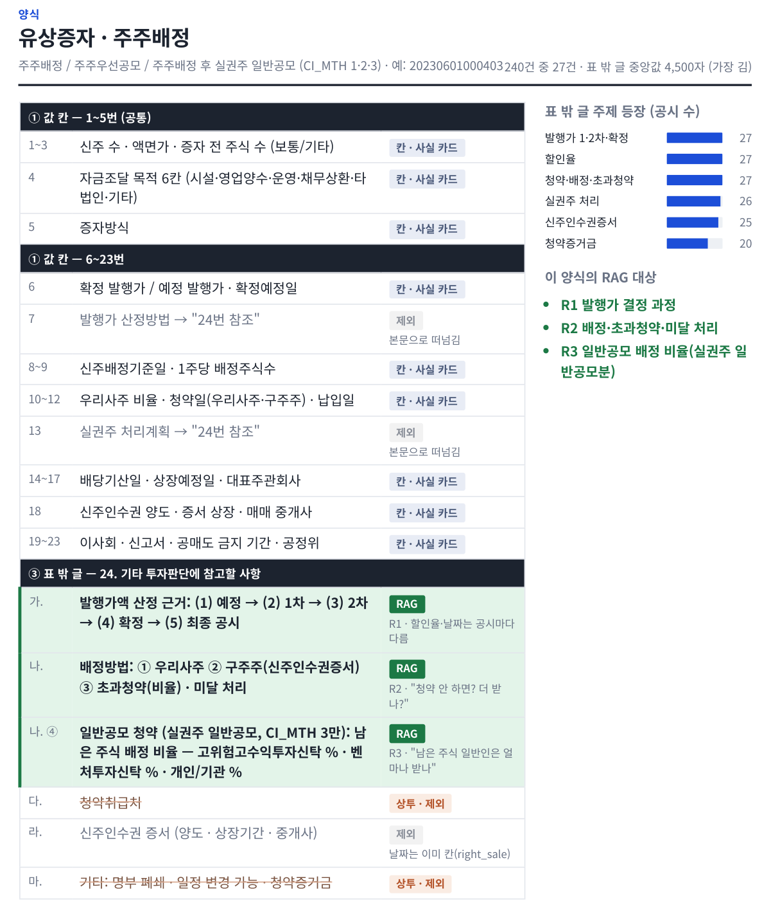
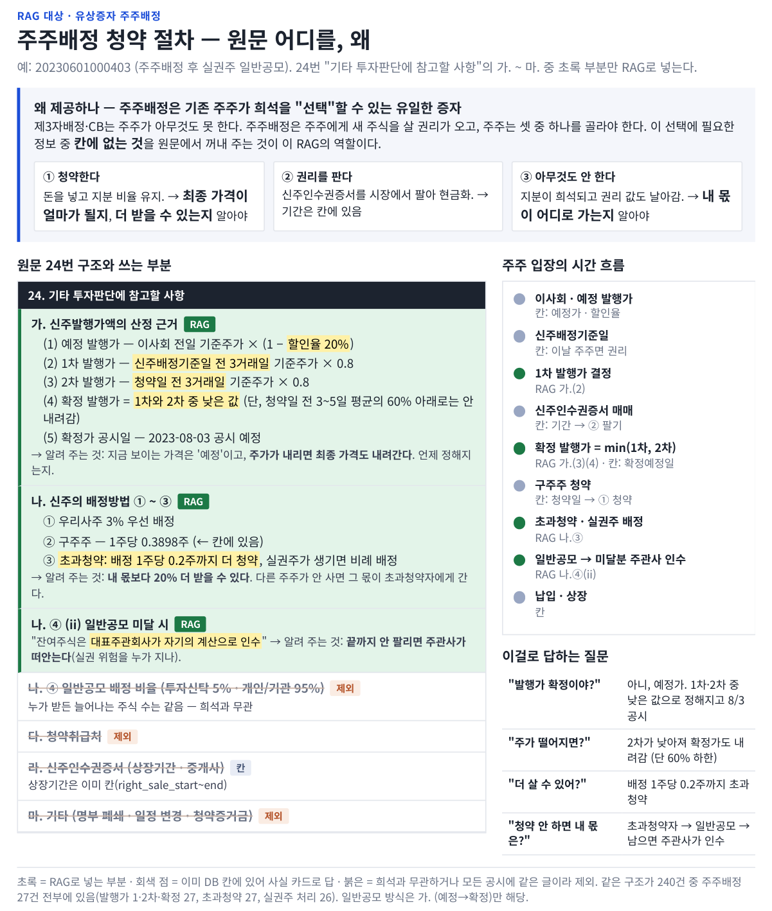
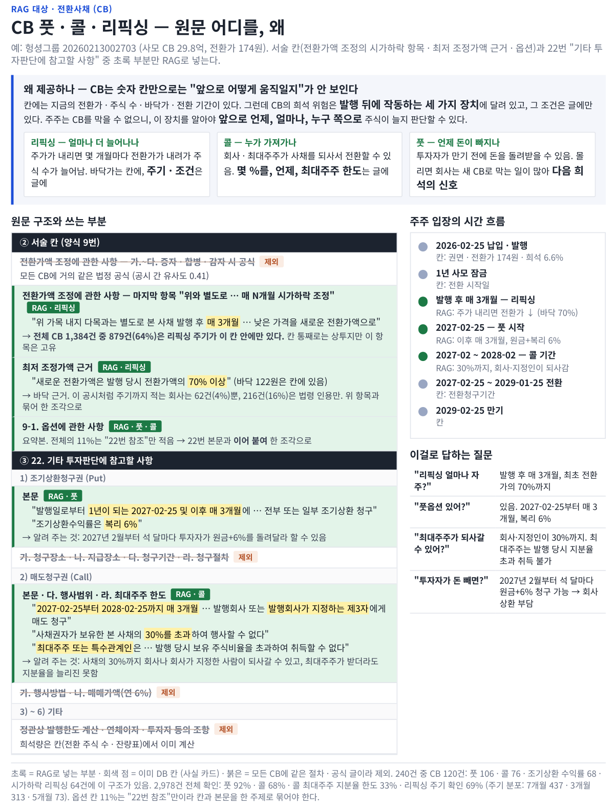

# 공시 원문 구조와 RAG 대상 분석

유상증자 · CB 공시 XML이 어떻게 생겼는지, 그중 어느 부분을 사실 카드(값 칸)로 쓰고 어느 부분을 원문 검색(RAG)으로 넣었는지 정리한 자료입니다.
README 3장의 요약을 여기서 자세히 봅니다.

## 분석 흐름
1. **240건 표본** (CB 120 · 주주배정 27 · 일반공모 22 · 제3자배정 71) → 양식별로 칸을 하나씩 분석 → **RAG 후보 9개 (R1~R9)**
2. **2,978건 전수 확인** → 칸에 이미 있거나 · 모든 공시에 같은 글(상투 문구)이거나 · 투자 판단에 약한 것을 빼고 → **최종 4개 (T1~T4)**: 청약절차 · 리픽싱 · 콜 · 풋
3. **일반공모 · 제3자배정**은 필요한 정보가 칸에 있어 RAG 없이 사실 카드로 답

| 자료 | 내용 |
|---|---|
| [공시양식_RAG대상.pdf](공시양식_RAG대상.pdf) | 1쪽 세 덩어리 · 고르는 기준 · R1~R9 / 2쪽 주주배정 / 3쪽 일반공모 / 4쪽 제3자배정 / 5쪽 CB / 6쪽 상투 문구 근거 |
| [주주배정_청약절차_RAG.pdf](주주배정_청약절차_RAG.pdf) | 최종 RAG 대상 T1 — 주주배정 24번 "기타 투자판단"의 어느 부분을 넣는지, 왜 |
| [CB_풋콜리픽싱_RAG.pdf](CB_풋콜리픽싱_RAG.pdf) | 최종 RAG 대상 T2~T4 — CB 서술 칸과 22번 표 밖 글의 어느 부분을 넣는지, 왜 |
| [rag_text_structure.md](rag_text_structure.md) | 위 분석의 글 버전 (2,978건 전수 확인 숫자 포함) |

## 양식별 칸 → 판정: 유상증자 주주배정



주주배정은 1~23번이 거의 다 값 칸(사실 카드)이고, 24번 표 밖 글의 가.(발행가 산정) · 나.(배정 · 초과청약 · 미달 처리)만 RAG 대상입니다.

일반공모(3쪽) · 제3자배정(4쪽) 양식은 [공시양식_RAG대상.pdf](공시양식_RAG대상.pdf)에 있습니다. 두 양식은 판단에 필요한 정보가 칸에 있어 최종 RAG 대상에서 빠졌습니다.

## 최종 RAG 위치



T1 청약절차 — 주주배정은 기존 주주가 "청약 · 권리 매도 · 아무것도 안 함" 중에 고르는 증자라, 그 선택에 필요한 확정 발행가 결정 · 초과청약 · 미달 처리를 원문에서 꺼내 줍니다.



T2 리픽싱 · T3 콜 · T4 풋 — CB는 발행 뒤에 작동하는 세 가지 장치(전환가 조정 · 회사의 매도청구 · 투자자의 조기상환청구)의 조건이 글에만 있습니다.

## 실제 XML 발췌: 유상증자 주주배정 (KC코트렐 20230601000403)

원문 그대로이고, 길거나 관계없는 줄은 `…`로 줄였습니다.

```xml
<TABLE-GROUP ACLASS="CST_CNT" ADELETETABLE="N">
…
<TD ALIGN="CENTER" WIDTH="172" HEIGHT="30" AUPDATECONT="N">보통주식 (주)</TD>
<TE ALIGN="RIGHT" WIDTH="268" HEIGHT="30" ACODE="CST_CNT">14,600,000</TE>
…
<TD ROWSPAN="2" ALIGN="CENTER" VALIGN="MIDDLE" WIDTH="93" HEIGHT="60" AUPDATECONT="N">예정발행가</TD>
<TD ALIGN="CENTER" VALIGN="MIDDLE" WIDTH="110" HEIGHT="30" AUPDATECONT="N">보통주식 (원)</TD>
<TE ALIGN="RIGHT" WIDTH="78" HEIGHT="30" ACODE="PRE_CST_VAL">2,400</TE>
…
<TD COLSPAN="3" WIDTH="334" HEIGHT="53" AUPDATECONT="N">7. 발행가 산정방법</TD>
<TE COLSPAN="3" WIDTH="308" HEIGHT="53" ACODE="ISS_FUNC">24. 기타 투자판단에 참고할 사항가. 신주 발행가액 산정방법 참조</TE>
…
<SPAN USERMARK=" B">24. 기타 투자판단에 참고할 사항</SPAN>
…
<SPAN USERMARK=" B">가. 신주발행가액의 산정 근거</SPAN>「증권의 발행 및 공시 등에 관한 규정」 제5-18조에 의거 주주배정 증자시 가격산정 절차 폐지 및 가격산정의 자율화에 따라 발행가격을 자유롭게 산정할 수 있으나, … 아래와 같이 산정합니다. …
…
<SPAN USERMARK=" B">다. 청약취급처</SPAN>
```

| 원문 | 어디로 | 이유 |
|---|---|---|
| `ACODE="CST_CNT"` 14,600,000 | DB `rights_values.new_shares` → 사실 카드 | 값 칸 (희석률 분자) |
| `ACODE="PRE_CST_VAL"` 2,400 | DB `price` · `price_status=예정` → 사실 카드 (`price_pending_display`) | 값 칸 |
| `ACODE="ISS_FUNC"` "24번 … 참조" | 제외 | 칸이 본문으로 떠넘김 — 내용은 24번 가.에 있음 |
| 24번 가. 신주발행가액의 산정 근거 | **RAG 주제 T1 (청약절차)** | 확정 발행가가 언제 · 어떻게 정해지는지는 글에만 있음 |
| 24번 다. 청약취급처 | 제외 (상투) | 모든 공시에 같은 절차 정보, 판단에 쓰이지 않음 |
